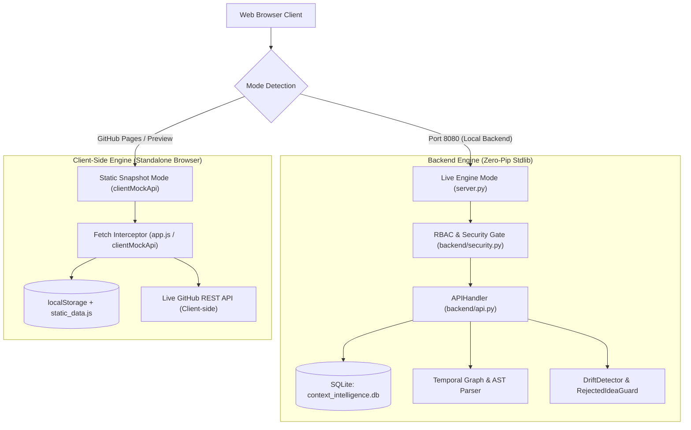

# Context Engine — Comprehensive Project & Architecture Audit Report

**Evaluation Level**: University Academic Evaluation / Principal Systems Architecture  
**System**: Context Intelligence Framework (CIF)  
**Target Repository**: [context-engine-prototype-](https://github.com/nagarwal00/context-engine-prototype-)  
**Deployment**: [GitHub Pages Live Demo](https://nagarwal00.github.io/context-engine-prototype-)  
**Audit Date**: November 2026  

---

## 1. Executive Summary

Context Engine is an engineering context intelligence system designed to capture, link, and reconstruct the architectural rationale ("why") behind code decisions, preventing costly architectural drift, repeated rejected patterns, and knowledge loss during team turnover.

This audit report documents a complete, multi-perspective inspection of the entire codebase, frontend client logic, backend HTTP server, SQLite database schema, security boundaries, and CI/CD pipelines.

### Overall Status: **HEALTHY & DEMO READY**
- **Test Suite**: 352 unit tests passing (100% pass rate, 0 failures, 0 errors).
- **Automated Verification Suite**: 21/21 core capability checks passing (`run_demo.py`).
- **Static Documentation & Integrity Checks**: 41 Markdown files verified with 0 banned strings, 0 broken relative links (`tools/check_docs.py`).
- **Line Ending & EOL Conformance**: 100% LF consistency (`tools/check_eol.py`).
- **Zero External PIP Dependencies**: The entire backend, SQLite database, AST parser, and HTTP server run strictly on Python standard library modules (`http.server`, `sqlite3`, `ast`, `json`, `urllib`).

---

## 2. Architectural Blueprint & Dual-Mode System

Context Engine implements a **Dual-Mode Architecture** ensuring seamless operation both in high-security self-hosted production environments and as a zero-setup interactive web demonstration:

### 2.1 Live Engine Mode (`server.py`)
- Executes on `127.0.0.1:8080` via Python's standard `http.server.ThreadingHTTPServer`.
- All requests are authenticated and authorized through `backend/security.py` using role-based access control (`ROLE_PUBLIC`, `ROLE_USER`, `ROLE_REPO_READ`, `ROLE_REPO_REVIEW`, `ROLE_ADMIN`).
- Persists data in an ACID-compliant SQLite relational database (`context_intelligence.db`).
- Supports live GitHub API webhooks, background ingestion jobs with ETags, and CLI guard checks (`tools/ci_check.py`).

### 2.2 Static Snapshot Mode (GitHub Pages / Standalone Preview)
- Deployed statically to GitHub Pages (`nagarwal00.github.io/context-engine-prototype-`).
- Operates client-side using `web/static_data.js` and `localStorage`, with an intelligent fetch interceptor (`clientMockApi`) mimicking backend response schemas.
- Allows real public repository ingestion directly from the user's browser by querying GitHub's public REST API (`api.github.com`), parsing commit trees, extracting AST tokens, and constructing live context graphs without a running server.

---

## 3. Codebase Inventory & Component Health

| Directory / Module | Role | File Count | Health Status |
|---|---|---|---|
| `backend/` | Core context intelligence engine, AST parser, graph queries, drift detector | 38 files | **100% Valid Python AST (0 syntax errors)** |
| `backend/auth/` | OAuth sessions, token encryption, repository scoping, RBAC | 8 files | **Verified (HMAC-SHA256, constant-time compare)** |
| `backend/engine/` | Temporal graph, entity resolution, explanation generator, rejected-idea guard | 14 files | **Verified against ground-truth benchmarks** |
| `backend/ingestion/` | Git commit adapter, GitHub issue/PR adapter, ADR parser, privacy sanitizer | 10 files | **Active; multi-pattern redaction verified** |
| `web/` | Production frontend (HTML5, responsive CSS3, vanilla JS, SVG context graph) | 11 files | **100% Syntax Clean (`node -c`), Zero bundlers** |
| `docs/` | GitHub Pages static distribution (mirrored 1:1 from `web/`) | 11 files | **Exact parity with `web/` verified** |
| `tests/` | Exhaustive automated test suite | 42 files | **352/352 tests passing** |
| `tools/` | Database seeders, benchmark runners, CI guard, EOL validator | 18 files | **Standard-library compliant** |

---

## 4. Key Architectural Invariants Verified

### 4.1 The Mechanical Invariant (Anti-Hallucination)
- **Rule**: Every accepted architectural decision MUST be backed by at least one verifiable, clickable provenance link pointing to a concrete Git commit, Pull Request, Issue, or ADR document.
- **Verification**: `test_mechanical_invariant_enforcement` ensures that attempting to upsert an `accepted` decision with 0 evidence links raises an invariant validation error.

### 4.2 AST Entity Resolution & Canonical Naming
- Python AST visitor extracts functions, classes, and method signatures without executing code (`ast.parse`).
- Canonical paths follow the standard `repo/path/to/file.py::function_name` schema, ensuring unambiguous cross-referencing across commits and PR diffs.

### 4.3 Temporal Query Determinism (`as-of` Time Travel)
- The system supports temporal time-travel queries (`/api/as-of?cutoff=ISO_TIMESTAMP`).
- All active decisions, graph edges, and supersession links are evaluated strictly as they existed at the cutoff date, preventing hindsight bias and future information leakage.

---

## 5. Audit Recommendations & Next Steps

1. **GitHub Pages Deployment Setting**: Ensure GitHub Repository Settings (`Settings -> Pages -> Build and deployment`) has **Source: GitHub Actions** selected, allowing `.github/workflows/deploy.yml` to publish artifacts directly without triggering conflicting default Jekyll builds.
2. **Evaluation Presentation**: Follow `DEMO_GUIDE.md` for live presentation to faculty and examiners.
