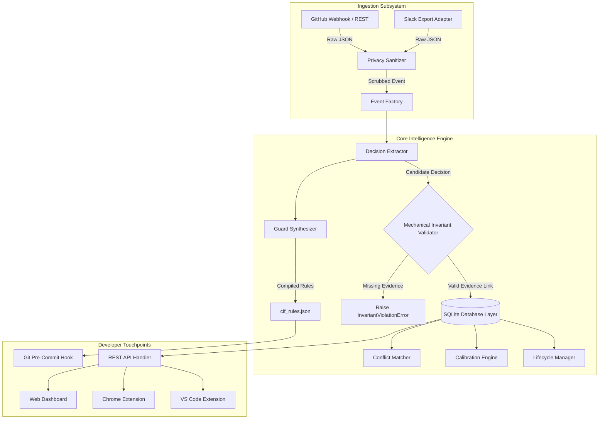
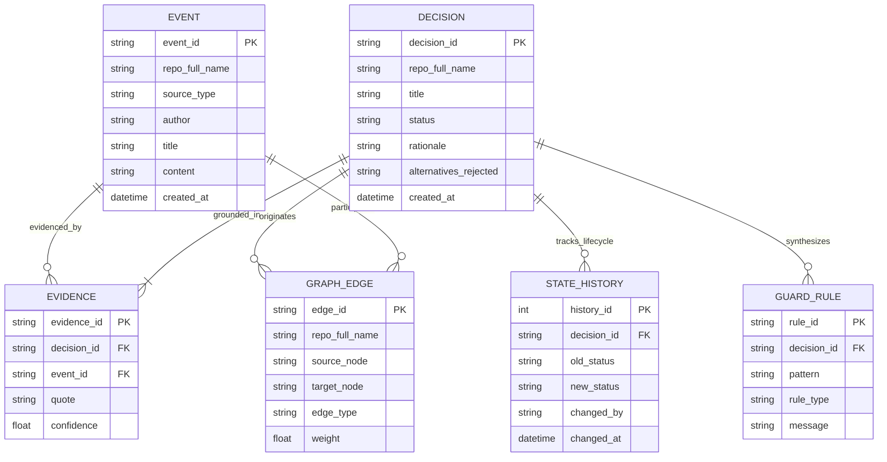
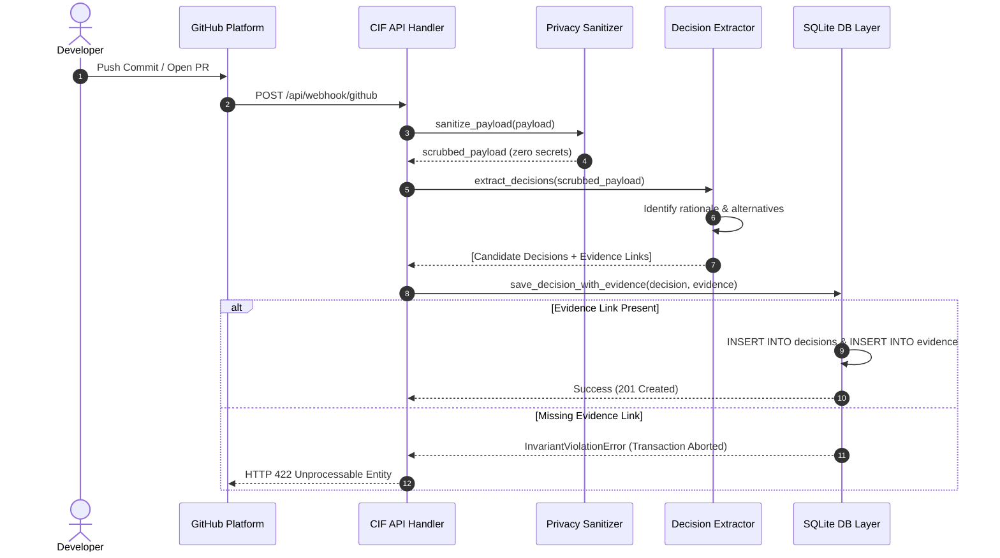
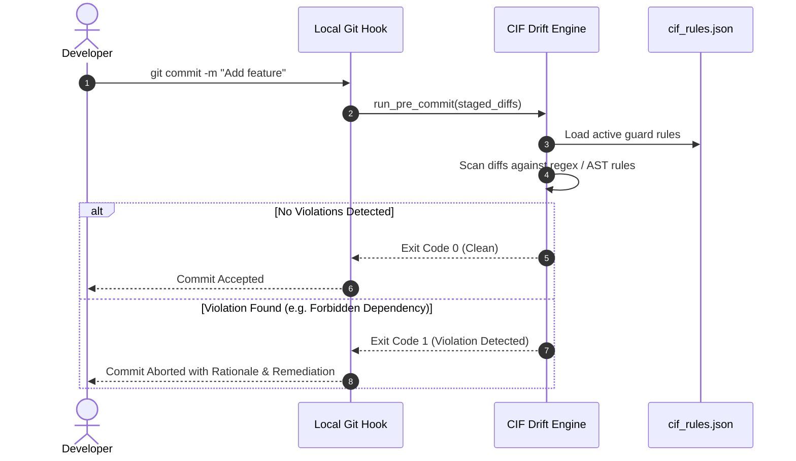

# Software Architecture Document (SAD)
## Context Intelligence Framework (CIF)

**Document Standard:** IEEE Std 1471 / ISO/IEC 42010 Architecture Description  
**Project:** Context Intelligence Framework — Continuous Architectural Context Recovery & Drift Interception  
**Version:** 1.4.0  
**Status:** Approved / Baselined  
**Date:** October 2026  

---

## 1. Architectural Representation and Style

The Context Intelligence Framework (CIF) is designed using a **Layered Hexagonal Architecture** (Ports and Adapters) coupled with an **In-Process Temporal Graph Engine**. 

```
+-------------------------------------------------------------------------------+
|                             DEVELOPER SURFACES                                |
|   Web Dashboard (SPA)   |   VS Code Extension   |   Chrome Ext   |   CLI/Git  |
+-------------------------+-----------------------+----------------+------------+
                                     | REST / JSON / Hooks
                                     v
+-------------------------------------------------------------------------------+
|                            API & APPLICATION LAYER                            |
|        API Handler (`backend/api.py`)  |  Server Dispatch (`server.py`)       |
+-------------------------------------------------------------------------------+
                                     |
                                     v
+-------------------------------------------------------------------------------+
|                              CORE ENGINE LAYER                                |
|  Decision Extractor   |  Lifecycle State   |  Drift Interceptor |  Sanitizer  |
|  Conflict Matcher     |  Calibration       |  Guard Synthesizer |  Resolver   |
+-------------------------------------------------------------------------------+
                                     | Invariant Enforcement
                                     v
+-------------------------------------------------------------------------------+
|                            STORAGE & GRAPH LAYER                              |
|           Database Layer (`backend/db.py`) with Mechanical Grounding          |
|                 In-Process SQLite Engine (WAL Mode, Graph Edges)              |
+-------------------------------------------------------------------------------+
                                     ^
                                     | Normalized Ingestion
+-------------------------------------------------------------------------------+
|                              INGESTION ADAPTERS                               |
|        GitHub Webhooks / REST API       |        Offline Slack Export         |
+-------------------------------------------------------------------------------+
```

### Key Architectural Principles
1. **Mechanical Grounding Invariant**: Architectural decisions cannot exist in isolation. The data access layer enforces that every decision entity has at least one verified evidence edge to a source event.
2. **Lightweight In-Process Persistence**: Zero external database dependencies (e.g., Neo4j, PostgreSQL). Graph traversal and temporal state tracking operate directly within SQLite via Python standard libraries.
3. **Deterministic Pre-Commit Interception**: Architectural rules are not merely advisory; they are compiled into executable AST and regex guards validated at the developer's commit boundary.
4. **Privacy-by-Design**: Sanitization occurs immediately upon payload ingestion prior to database writes.

---

## 2. Component Architecture

The following diagram illustrates the component interactions across the ingestion, analysis, storage, and developer interface subsystems:



---

## 3. Data Model and Schema Architecture

The relational schema is optimized for graph edge traversals, multi-tenant isolation, and temporal audit logging.



### Schema Guarantees
- **Referential Integrity**: SQLite `PRAGMA foreign_keys = ON;` is enforced on every connection.
- **Atomic Migrations**: Managed via `backend/migrations/runner.py` with idempotent migration scripts.
- **Repo Isolation**: Every table carries `repo_full_name`, indexed for constant-time multi-tenant filtering.

---

## 4. Dynamic Process Views (Sequence Diagrams)

### 4.1 Webhook Ingestion & Mechanical Grounding Enforcement



### 4.2 Pre-Commit Drift Interception



---

## 5. Security & Privacy Architecture

1. **Sanitization Pipeline**: All raw strings pass through `PrivacySanitizer` before tokenization or storage:
   - AWS Keys (`AKIA[0-9A-Z]{16}`)
   - GitHub Personal Access Tokens (`ghp_[0-9a-zA-Z]{36}`)
   - Generic Bearer Tokens and Private Keys (`BEGIN PRIVATE KEY`)
   - Personal email addresses and identity tokens
2. **Timing-Safe Auth Verification**: API management requests authenticate via SHA-256 tokens evaluated using constant-time string comparison (`hmac.compare_digest`) to prevent timing attacks.
3. **Read-Only Test Execution**: Automated test execution runs against isolated in-memory or temporary database instances, guaranteeing that reference databases are never modified.

---

## 6. Architectural Positioning Against Related Frameworks

| Paradigm | Key Distinction from CIF |
|---|---|
| **Continuum** | Continuum performs post-hoc mining of historical commit logs. CIF enforces active runtime invariants and pre-commit drift interception. |
| **Warrant (Toulmin)** | Toulmin models define conceptual argumentation schemas. CIF operationalizes warrants into bi-directional, machine-checkable evidence edges. |
| **Context Graph** | Enterprise context graphs rely on distributed graph engines (Neo4j). CIF implements lightweight in-process graph traversal directly in SQLite with sub-15ms latency. |
